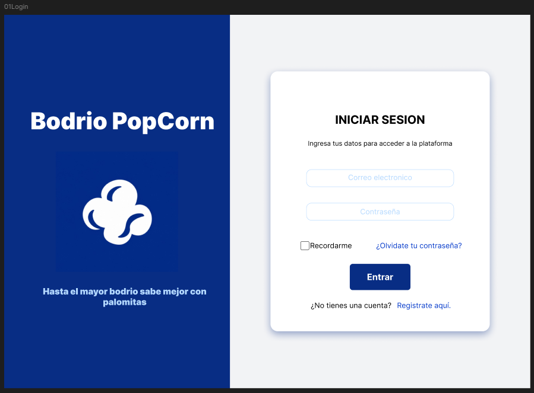
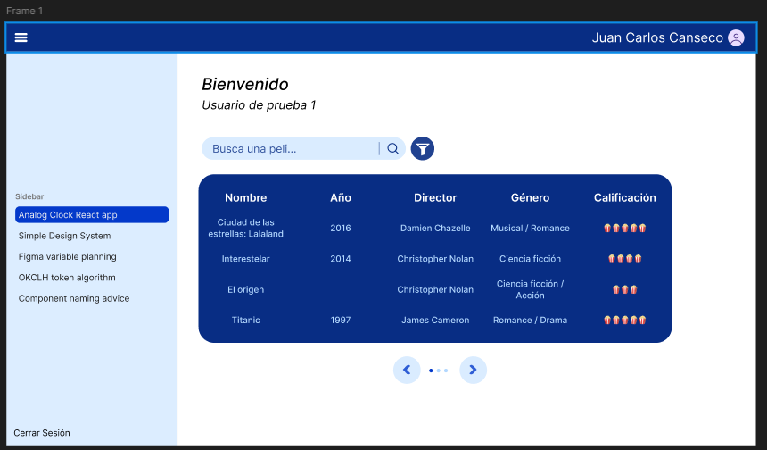
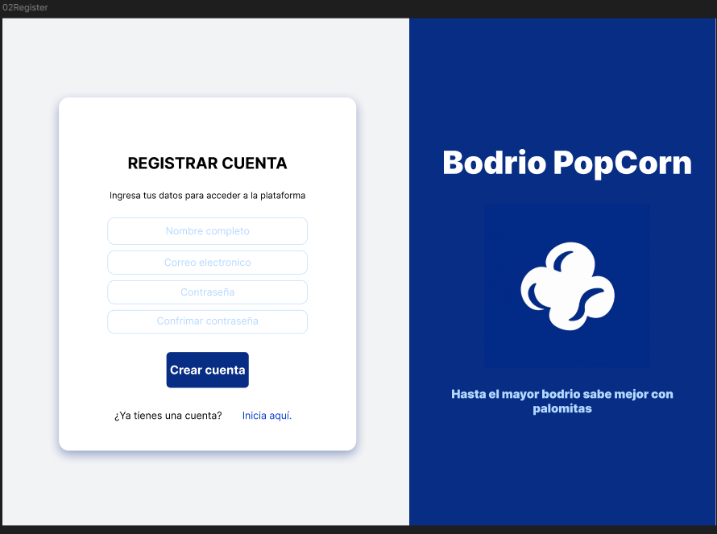

# Bodrio PopCorn

Bodrio PopCorn es una pequeña aplicación web desarrollada con React para gestionar un catálogo de productos con autenticación y operaciones CRUD. La plataforma simula un sistema de administración de cine/popcorn (tema visual del proyecto) y conecta con la API pública de DummyJSON para validar usuarios y manipular productos en tiempo real.

## Integrantes

- Navarro Vazquez Jonathan de Jesus
- Perez Cruz Maria Isabel
- Canseco Reyes Juan Carlos

## Tecnologías utilizadas

- React
- Vite
- JavaScript
- Fetch API
- DummyJSON

## Descripción general

La aplicación tiene dos grandes partes:

1. Autenticación de usuario: el usuario inicia sesión con su usuario y contraseña.
2. Panel de administración del catálogo: una vez autenticado, se muestra la colección de productos con opciones de búsqueda, filtrado, paginación y gestión CRUD.

## Cómo se usan las APIs

### 1) API de autenticación: DummyJSON Auth

Endpoint principal:
- `POST https://dummyjson.com/auth/login`

Esta API se usa para validar credenciales del usuario y devolver la información del perfil autenticado. En la aplicación se invoca desde `src/services/api.js` con `loginUser(username, password)`.

Funcionamiento dentro del proyecto:
- El formulario de login captura el usuario y la contraseña.
- Se envían al backend con `fetch` usando `method: 'POST'`.
- Si la autenticación es correcta, la respuesta incluye datos como `firstName`, `lastName`, `username`, `image`, etc.
- Ese usuario se guarda en `sessionStorage` o `localStorage` para mantener la sesión activa.
- Si las credenciales son incorrectas, la interfaz muestra un mensaje de error.

Ejemplo de uso:

```js
export function loginUser(username, password) {
  return request('/auth/login', {
    method: 'POST',
    headers: { 'Content-Type': 'application/json' },
    body: JSON.stringify({ username, password }),
  })
}
```

Credenciales de prueba:

```text
Usuario: emilys
Contraseña: emilyspass
```

### 2) API de productos: DummyJSON Products

Endpoint base:
- `https://dummyjson.com/products`

Esta API se usa para consultar, crear, actualizar y eliminar productos. El archivo `src/services/api.js` centraliza estas llamadas para el resto de la aplicación.

#### Obtener categorías

- `GET /products/categories`
- Sirve para llenar el selector de categorías del catálogo.

#### Obtener productos con filtros y paginación

- `GET /products`
- `GET /products/category/:category`

La app usa estos endpoints para:
- cargar una página específica de productos,
- limitar la cantidad por página,
- buscar por nombre,
- filtrar por categoría,
- sincronizar estos valores con la URL (`?page=...&limit=...&search=...&category=...`).

Ejemplo:

```js
export function getProducts({ page, pageSize, search, category, signal }) {
  const skip = (page - 1) * pageSize
  const endpoint = category ? `/products/category/${encodeURIComponent(category)}` : '/products'
  const query = new URLSearchParams({ limit: pageSize, skip })
  if (search) query.set('q', search)
  return request(`${endpoint}?${query}`, { signal })
}
```

#### Crear producto

- `POST /products/add`
- Se usa cuando el usuario hace clic en “Agregar producto”.
- La información ingresada en el modal se envía a la API y luego se agrega al listado local para actualizar la vista inmediatamente.

#### Editar producto

- `PUT /products/{id}`
- Se usa para modificar un producto ya existente.
- La app pide confirmación antes de guardar el cambio y actualiza el registro sin recargar la página.

#### Eliminar producto

- `DELETE /products/{id}`
- Elimina un producto de la base de datos remota y luego se quita del estado local para reflejar el cambio en la tabla.

## Flujo de uso de la aplicación

### Inicio de sesión

Cuando la app se ejecuta, se verifica si hay un usuario guardado. Si no existe, se muestra la pantalla de login.

La pantalla de login tiene:
- campo de usuario o correo,
- campo de contraseña,
- opción “Recordarme”,
- validación de campos vacíos,
- manejo de errores si las credenciales son incorrectas,
- acceso con las credenciales de prueba.



### Panel principal y menú lateral

Después de iniciar sesión, la aplicación despliega la estructura principal:
- sidebar con opciones de navegación,
- navbar con información del usuario,
- espacio de contenido principal donde se carga el catálogo.

La navegación incluye:
- Catálogo de películas
- Mis favoritas
- Configuración

Actualmente el catálogo es la sección funcional principal y las demás se muestran como próximas implementaciones.

### Catálogo de productos

La pantalla principal del sistema permite:
- ver la lista de productos en una tabla,
- buscar un producto por nombre,
- filtrar por categoría,
- seleccionar la cantidad de registros por página,
- navegar entre páginas,
- crear, editar y eliminar productos.

La pantalla se apoya en la API de productos y en el estado local del componente para dar una experiencia fluida sin recargar la página.



### Modal de alta/edición

El modal permite ingresar la información del producto y decidir si se crea uno nuevo o se actualiza uno existente.

Los campos relevantes suelen incluir:
- título,
- descripción,
- precio,
- categoría,
- stock,
- marca,
- puntuación,
- envío, entre otros.

La forma en que se guarda depende del caso:
- si se está creando, usa `createProduct()`;
- si se está editando, usa `updateProduct(productId, product)`.

### Sección de favoritos y configuración

Aunque el proyecto principal está centrado en el catálogo, la interfaz ya contempla dos secciones extra dentro del sidebar:
- “Mis favoritas”: pensado para mostrar productos guardados por el usuario.
- “Configururación”: pensado para ajustes y opciones del sistema.

Estas pantallas aún están preparadas como placeholders para ampliar la aplicación en futuras versiones.



## Instalación y ejecución

```bash
npm install
npm run dev
```

## Link del proyecto

http://74.208.173.233/t3_act8_eq04/

## Cómo probar la app

1. Abre la aplicación en el navegador.
2. Ingresa las credenciales de prueba.
3. Verifica que se cargue la vista del catálogo.
4. Prueba la búsqueda y el filtro por categoría.
5. Agrega un producto con el botón “Agregar producto”.
6. Edita uno desde la tabla y confirma el cambio.
7. Elimina un producto y revisa que la lista actualiza correctamente.
